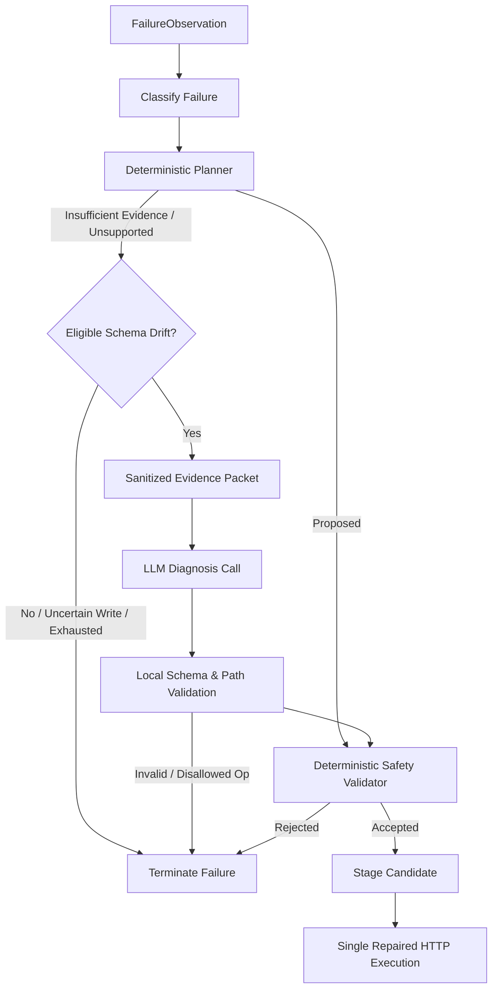

# DriftGuard Integration Guide

This document specifies the integration contracts and communication channels between all components.

## 1. Port Allocation & Endpoints
| Component | Local Host / Port | Responsibilities |
|---|---|---|
| **Mock API** | `http://127.0.0.1:8001` | Simulated ticketing & user directory service; drift mutation injection |
| **Orchestrator** | `http://127.0.0.1:8000` | Tool registry, execution engine, SSE stream, healing pipeline, metrics |
| **Frontend** | `http://127.0.0.1:5173` | React/Vite dashboard, live timeline, comparison panels |

---

## 2. Downstream Client Architecture (Member 2 Foundation)

### 2.1 Importing & Injecting the Client
The orchestrator provides an injectable async client in `orchestrator.client`:

```python
from orchestrator.client import MockBusinessApiClient, MockApiClientError

# Injected client with custom transport for isolated testing:
client = MockBusinessApiClient(
    base_url="http://127.0.0.1:8001",
    timeout=10.0,
    transport=custom_transport,
    credential_resolver=lambda ref: "vault-token" if ref == "secops_auth" else None
)
```

### 2.2 Client Ownership & Lifecycle Cleanup
Clients can be managed either via context manager or explicit lifespan:

```python
# Context Manager pattern:
async with MockBusinessApiClient(base_url="http://127.0.0.1:8001") as client:
    result = await client.find_user(name="Maya")

# FastAPI Lifespan pattern:
@asynccontextmanager
async def lifespan(app: FastAPI):
    app.state.registry = VersionedToolRegistry.create_default()
    app.state.mock_client = MockBusinessApiClient(base_url=settings.mock_api_url)
    yield
    await app.state.mock_client.aclose()
```

### 2.3 Strict Security Segregation
- `MockBusinessApiClient`: Exposes **ONLY** business methods (`find_user`, `assign_ticket`, `get_ticket`, `execute_tool`). Admin methods (`reset`, `mutation`, `state`) are strictly absent.
- `MockAdminApiClient`: Dedicated exclusively to admin operations for testing and reset forwarding. Never imported by the healing diagnosis engine.

---

## 3. Versioned Tool Registry Integration (Member 2 Registry Lifecycle)

### 3.1 Registry Initialization & Injection
The `VersionedToolRegistry` is initialized on `app.state.registry` via `create_default()` containing the three canonical tools: `find_user`, `assign_ticket`, and `get_ticket`.

```python
from orchestrator.registry import VersionedToolRegistry

registry = VersionedToolRegistry.create_default()
```

### 3.2 Active & Historical Lookups
All read operations return defensive deep copies to protect internal state:

```python
# Active tool lookup
tool = registry.get("assign_ticket")

# Listing all active tools
tools = registry.list_active()

# Historical lookup
old_version = registry.get_version("assign_ticket", "1.0.0")
history = registry.get_history("assign_ticket")
```

### 3.3 Candidate Staging, Discard & Atomic Commit
```python
# 1. Stage candidate (validates schema, rejects endpoint/method/name identity changes, derives target version)
candidate = await registry.stage_candidate(
    tool_name="assign_ticket",
    candidate_definition=candidate_def,
    base_version="1.0.0"  # Optional; defaults to active version
)
# Returns StagedCandidate(candidate_id="cand-...", target_version="1.1.0", status="staged")

# 2. If recovery fails verification: discard candidate
registry.discard_candidate(candidate.candidate_id)

# 3. If recovery succeeds verification: atomic version-checked commit
# Requires matching expected base version to prevent race conditions
committed_tool = await registry.commit_candidate(
    candidate_id=candidate.candidate_id,
    expected_base_version="1.0.0"
)
```

### 3.4 Per-Tool Lock Ownership Semantics
- Each tool has an independent `AsyncRLock` accessed via `registry.tool_lock(tool_name)`.
- Locking `assign_ticket` does not block lookups or modifications on `find_user` or `get_ticket`.
- Locks are task-reentrant: future recovery workflows can hold the tool lock across diagnosis, retry, and verification, and safely invoke `commit_candidate` without deadlocking.

---

## 4. Normal Tool Execution Architecture (Member 2 Task 3)

### 4.1 ToolExecutor API & Lifecycle
The `ToolExecutor` provides deterministic, registry-driven tool execution without hardcoded payload assembly:

```python
from orchestrator.execution.tool_executor import ToolExecutor
from orchestrator.models import ExecutionContext

executor = ToolExecutor(
    registry=app.state.registry,
    client=app.state.mock_client
)

context = ExecutionContext(
    run_id="run-12345",
    tool_call_id="call-find-abc",
    idempotency_key="dg-idemp-uuid-42"
)

result = await executor.execute(
    tool_name_or_def="assign_ticket",
    arguments={"ticket_id": 81, "user_id": "123"},
    context=context,
    candidate_snapshot=None  # Optional staged candidate definition
)
```

### 4.2 Executor Inputs and Results
- **Inputs**:
  - `tool_name_or_def`: Name string or pre-supplied `ToolDefinition` snapshot.
  - `arguments`: Dict of input arguments (deep-copied; caller inputs are strictly immutable).
  - `context`: `ExecutionContext` carrying `run_id`, `tool_call_id`, `idempotency_key`, and metadata.
  - `candidate_snapshot`: Optional candidate definition to test-execute in isolation without activating in the registry.
- **Output (`ExecutionResult`)**:
  - `is_success`: bool indicating overall execution success.
  - `outcome`: Dict of extracted response values according to declared `response_mapping`.
  - `http_status`: HTTP status code (or `0` for pre-network validation/credential errors).
  - `failure`: `SanitizedFailure` if execution failed, with `failure_category` and secret scrubbing.
  - `registry_version`: Monotonic version of tool used.
  - `fingerprint`: Deterministic SHA-256 canonical contract fingerprint.
  - `timing`: `TimingInfo` with wall-clock UTC start/complete and duration in milliseconds.
  - `operation_identity`: `OperationIdentity` tying tool name, endpoint, method, call ID, run ID, and idempotency key.

### 4.3 Supported Mapping Syntax
- **No Executable Code**: Mappings are purely declarative; dynamic `eval`, `exec`, or code execution is strictly prohibited.
- **Top-Level Keys Supported**: `path_params`, `query_params`, `headers`, `body`. Any other top-level key is rejected with `UnsupportedMappingError`.
- **Type Preservation**:
  - Single placeholder `{field}` preserves the native argument type (e.g. integer `81` remains integer `81`, not converted to `"81"`).
  - Composite string `{prefix}_{field}` performs standard string interpolation.
  - Nested dictionary and list trees are traversed recursively with full type preservation.
- **Response Extraction**:
  - Dot and bracket JSONPath notation without eval: `$[0].id`, `$.ticket_id`, `$.target.id`, `$.history`.
  - Optional dictionary keys resolve safely to `None` if omitted by downstream responses.

### 4.4 Logical Execution Identity & Idempotency Key Semantics
- **Operation Identity**: `OperationIdentity` tracks `tool_name`, `endpoint`, `method`, `tool_call_id`, `run_id`, and `idempotency_key`.
- **Idempotency on Writes**: All mutation writes (`POST`, `PUT`, `PATCH`, `DELETE`) require a stable idempotency key sent via `Idempotency-Key` header.
- **Stable Logical Identity**: Explicit replays of the same logical operation reuse the exact same `idempotency_key`. Distinct operations receive freshly generated UUIDs (`dg-idemp-...`).
- **Separation from Workflow ID**: The workflow `run_id` is never used as an idempotency key to prevent cross-tool key collision.

### 4.5 Failure Categories & Write Uncertainty
- **Failure Categories (`FailureCategory`)**:
  - `VALIDATION_FAILURE`: Local argument validation failed against argument JSON Schema prior to network execution (**zero** HTTP calls).
  - `CREDENTIAL_FAILURE`: Required credential reference missing from resolver prior to network execution (**zero** HTTP calls).
  - `TRANSPORT_FAILURE`: Downstream connection refused, network timeout, or socket drop.
  - `HTTP_REJECTION`: Downstream HTTP response with status code >= 400.
  - `RESPONSE_PARSING_FAILURE`: HTTP 2xx response that cannot be parsed as JSON or violates required response mapping.
- **Write Uncertainty (`uncertain_write = True`)**:
  - When a write (`POST /tickets/assign`) experiences a transport failure or post-write response parsing failure, `uncertain_write` is flagged as `True`.
  - In adherence to ADR-002, the executor **never automatically retries** an uncertain write. Verification reads must be performed before any future recovery retry.

### 4.6 Verification & Ambiguity Semantics
- **User Ambiguity Guard**: The workflow resolves Maya via `find_user`. If zero users or multiple users are returned, the workflow halts immediately with an explicit failure before mutating ticket assignment state.
- **Independent Read Verification**: Step 3 (`get_ticket`) reads ticket 81 and asserts `actual_assignee_id == intended_user_id` and `actual_ticket_id == 81`.
- **Non-Reliance on HTTP 200**: Returning HTTP 200 on `assign_ticket` alone never qualifies as success. If independent read verification shows an assignee mismatch, the workflow fails with an explicit verification mismatch error.

---

## 5. Model-Driven Baseline Agent Integration (Member 2 Task 4)

### 5.1 Architecture & Invariants
- **Genuine Tool Calling**: Driven by LangChain tool-calling agents (`google_genai` or `openai`).
- **Frozen Catalogue Isolation**: Derives tool specifications and candidate snapshots exclusively from `orchestrator/agents/catalogue.py` (`get_frozen_v1_catalogue()`). Commits or proposals in `VersionedToolRegistry` **never** alter baseline schemas or behavior.
- **Execution Limits**: Bound by configurable limits: `max_turns` (default: 5), `max_tool_calls` (default: 10), and overall deadline `timeout_seconds` (default: 30.0s).
- **Operation Identity**: Writes (`POST /tickets/assign`) compute a stable idempotency key mapped to `tool_name` + canonical sorted JSON arguments, preventing duplicate write side-effects within a task run.
- **Truthful Token Tracking**: Aggregates input, output, and total tokens from model metadata without double counting. If unavailable from the provider, explicitly sets `"unavailable"` (never synthesizes token counts). Baseline diagnosis tokens are strictly `0`.
- **Independent Verification Over Model Claims**: Completion is independently verified by reading downstream state via `get_ticket(81)` and matching `actual_assignee == resolved_user_id`. Model claims of "done" without matching downstream state are marked as `verification_failed`.

### 5.2 Invocation & Run Request Contract (For Member 1 & Evaluation)
Triggering a baseline model run:
```http
POST /runs HTTP/1.1
Content-Type: application/json

{
  "mode": "baseline",
  "execution_type": "model_driven_baseline",
  "task": "Find Maya's user ID, assign ticket 81 to her, and confirm the updated assignee.",
  "limits": {
    "max_turns": 5,
    "max_tool_calls": 10,
    "timeout_seconds": 30.0
  }
}
```

Response payload (`RunSummaryResponse`):
```json
{
  "run_id": "run-48afbc29-7981-420a",
  "status": "completed",
  "mode": "normal",
  "execution_type": "model_driven_baseline",
  "task": "Find Maya's user ID, assign ticket 81 to her, and confirm the updated assignee.",
  "created_at": "2026-10-14T12:00:00Z",
  "completed_at": "2026-10-14T12:00:02Z",
  "duration_ms": 1420.5,
  "outcome": {
    "ticket_id": 81,
    "target_user_name": "Maya",
    "resolved_user_id": "123",
    "verified_assignee_id": "123",
    "verified": true,
    "execution_type": "model_driven_baseline",
    "status": "assigned",
    "uncertain_write": false
  },
  "error": null,
  "model_usage": {
    "input_tokens": 320,
    "output_tokens": 75,
    "total_tokens": 395,
    "diagnosis_tokens": 0,
    "model_name": "gemini-2.5-flash",
    "provider": "google_genai"
  },
  "termination_reason": "completed_and_verified"
}
```

---

## 6. Failure Interception & Semantic Classification (Member 2 Task 5)

### 6.1 `FailureObservation` Schema
Constructed defensively at the shared `ToolExecutor` boundary upon any tool failure:
```python
class FailureObservation(BaseModel):
    tool_name: str
    registry_version: str
    fingerprint: str
    run_id: Optional[str]
    tool_call_id: Optional[str]
    idempotency_key: Optional[str]
    operation_identity: OperationIdentity
    execution_phase: ExecutionPhase  # PRE_VALIDATION, CREDENTIAL_RESOLUTION, REQUEST_MAPPING, HTTP_DISPATCH, RESPONSE_PARSING, READ_VERIFICATION
    method: str
    endpoint: str
    http_status: Optional[int]
    original_arguments: Dict[str, Any]       # Immutable caller snapshot
    request_evidence: Optional[Dict[str, Any]]
    response_evidence: Optional[Dict[str, Any]]
    validation_details: Optional[Dict[str, Any]]
    evidence_paths: List[str]
    timing: TimingInfo
    write_attempted: bool
    uncertain_write: bool                    # Preserves uncertain-write protection
    raw_error_message: Optional[str]         # Recursively redacted
    timestamp: str
```

### 6.2 Semantic Categories (`SemanticFailureCategory`)
| Category | Definition | Default Diagnosis Eligibility |
|---|---|---|
| `schema_drift` | Structured downstream schema mismatch evidence (`expected_schema`, `missing`, `unexpected`, `migration_hint`, newly required header). Identifies candidate for repair. | `True` |
| `invalid_input` | Pre-dispatch argument schema rejection by local JSON Schema Draft 7 validator. Represents bad caller input, not downstream drift. | `False` |
| `business_rule_rejection` | Downstream business logic rejection (`TICKET_CLOSED`, `TICKET_NOT_FOUND`, documented 404 for nonexistent resource). | `False` |
| `authentication_authorization` | Standard HTTP 401/403 credential or permission rejection without header drift evidence. | `False` |
| `transient_service_failure` | HTTP 429 rate limit, 500/502/503/504 server error, or network transport failure/socket timeout. | `False` |
| `ambiguous` | Bare HTTP 400/422 status codes without structured details, unrecognized status codes, or contradictory/malformed evidence. | `False` |

### 6.3 Retry Safety & Invariants (`RetrySafety`)
- **Uncertain Write Invariant**: If `uncertain_write == True` (e.g. transport disconnect or response parsing failure on a write), `safe_to_retry` is strictly `False`. This protection holds **even if** `diagnosis_eligible == True`.
- **Pre-Execution Invariant**: If rejected before HTTP dispatch (`PRE_VALIDATION`, `REQUEST_MAPPING`), `safe_to_retry` is `False` with `requires_input_adaptation == True`.
- **Idempotency Keys**: Supplying an `Idempotency-Key` does **not** prove server-side deduplication; writes with uncertain server outcome are never retried blindly.

---

## 7. Deterministic Repair Proposals (Member 2 Task 6)

### 7.1 Proposal Models & Status (`PlanningStatus`)
```python
class PlanningStatus(str, Enum):
    PROPOSED = "proposed"                       # Evidence is complete; coherent plan formulated
    INSUFFICIENT_EVIDENCE = "insufficient_evidence" # Missing correspondence or schema details
    UNSUPPORTED = "unsupported"                 # Unapproved header, invented business value, or collision
    NOT_ELIGIBLE = "not_eligible"               # Ineligible failure category or stale snapshot
```

### 7.2 Path Semantics & Distinct Layers
DriftGuard strictly separates three distinct layers of paths:
1. **Source Argument Path**: The caller's original business parameter (`user_id`, `ticket_id`). Original caller arguments remain **strictly immutable**.
2. **Wire Request Path**: The HTTP request wire structure (`body["assignee_id"]`, `body["target"]["id"]`, `headers["Authorization"]`). Updated via `request_mapping`.
3. **Argument Schema Path**: The local input validation contract in `argument_schema.properties`.

### 7.3 Supported Evidence Grammar
The planner normalizes only documented, machine-readable evidence:
- **Explicit Field Migration**:
  - `details.migration_mapping = {"user_id": "assignee_id"}`
  - Structured machine-readable hint: `"Field 'user_id' is deprecated. Expected 'assignee_id'."` or `"user_id is now nested under target.id"`.
- **Expected Schema Types**:
  - `details.expected_schema = {"ticket_id": "integer", "target": {"id": "integer"}}`
  - Declared conversion policy: `"string_to_integer"`
- **Required Headers**:
  - `details.required_headers = ["Authorization"]` or `["X-Org-Token"]`
  - Must map to a pre-approved credential reference name (`approved_header_credentials = {"Authorization": "secops_auth"}`).

### 7.4 Task 7 Validation Requirements
Proposals generated in Task 6 are declarative candidates labeled `status: "proposed_unvalidated"`. Task 7 must statically verify:
1. `verify_caller_argument_immutability`: Caller arguments (`ticket_id: 81`, `user_id: "123"`) must not be mutated or dropped.
2. `verify_no_invented_business_values`: The patch must never invent artificial IDs, priorities, or flags.
3. `verify_lossless_type_conversion`: Type conversions must be safe and lossless (e.g. numeric string `"123"` to `123`).
4. `verify_approved_credential_resolution`: Headers must map to approved credential references without fabricating secrets.
5. `verify_idempotent_retry_safety`: Uncertain writes (`uncertain_write == True`) must never be retried.

---

## 8. Contract Gaps & Coordination Handoffs

### 8.1 For Member 1 (Mock API & Mutations) — Proposal Evidence & Refusal Examples
The deterministic planner enforces strict evidence requirements:
1. **Missing Field Alone Refusal (`insufficient_evidence`)**:
   - If mock returns `{"error": {"details": {"missing": ["assignee_id"]}}}`, DriftGuard **refuses** to guess that `assignee_id` replaces `user_id`.
   - **Requirement**: Provide explicit correspondence: `details.migration_mapping = {"user_id": "assignee_id"}` or `migration_hint = "Use assignee_id instead of user_id"`.
2. **Unapproved Required Header Refusal (`unsupported`)**:
   - If mock returns `401` with `required_headers = ["X-Custom-Secret"]` and that header is not in approved orchestrator configuration, DriftGuard **refuses**. Credentials cannot be fabricated.
3. **Newly Required Business Parameter Refusal (`unsupported`)**:
   - If mock returns `missing: ["priority_tier"]`, DriftGuard **refuses**. The agent cannot invent ungrounded business values.

### 8.2 For Member 3 (Frontend & SSE Events) — Representative Event Payloads

#### Representative `tool_call_failed` Event Payload with Classification:
```json
{
  "run_id": "run-48afbc29-7981-420a",
  "sequence": 4,
  "timestamp": "2026-10-14T12:00:01.250Z",
  "mode": "normal",
  "type": "tool_call_failed",
  "tool": "assign_ticket",
  "data": {
    "status_code": 422,
    "error_code": "schema_mismatch",
    "message": "Field 'user_id' is deprecated. Expected 'assignee_id'.",
    "uncertain_write": false,
    "classification": {
      "category": "schema_drift",
      "diagnosis_eligible": true,
      "safe_to_retry": false,
      "retry_reason": "Downstream server rejected the request schema. Repeating identical payload will deterministically fail; input adaptation is required."
    }
  }
}
```

#### Representative `patch_proposed` Event Payload (Unvalidated Candidate):
```json
{
  "run_id": "run-48afbc29-7981-420a",
  "sequence": 5,
  "timestamp": "2026-10-14T12:00:01.350Z",
  "mode": "healing",
  "type": "patch_proposed",
  "tool": "assign_ticket",
  "data": {
    "proposal_id": "prop-b4f2c8d19a02",
    "tool": "assign_ticket",
    "base_version": "1.0.0",
    "target_version": "1.1.0",
    "proposal_fingerprint": "b4f2c8d19a02ec71",
    "status": "unvalidated_proposal",
    "validation_required": true,
    "operations": [
      {
        "operation_type": "set_header",
        "source_path": null,
        "target_path": "Authorization",
        "conversion_policy": null,
        "credential_reference": "secops_auth"
      },
      {
        "operation_type": "nest_argument",
        "source_path": "user_id",
        "target_path": "target.id",
        "conversion_policy": null,
        "credential_reference": null
      },
      {
        "operation_type": "cast_type",
        "source_path": "user_id",
        "target_path": "target.id",
        "conversion_policy": "string_to_integer",
        "credential_reference": null
      }
    ]
  }
}
```

---

## 10. Deterministic Safety Validation (Member 2 Task 7)

### 10.1 Architecture & Inputs
The safety validator (`orchestrator/healing/validator.py`) statically inspects declarative proposals before any live execution or registry staging.
Inputs:
- Captured `ToolDefinition` snapshot and immutable `original_arguments`.
- `FailureObservation` and `ClassificationResult`.
- `PlanningResult` / `RepairProposal`.
- Current active registry snapshot.
- Read-only approved header-to-credential bindings.
- Injected local credential-availability resolver callable.
- Execution guarantees (`pre_execution_rejection`, etc.).

### 10.2 Strict Invariant Checks
1. **Freshness & Identity Gating**: Snapshot, observation, proposal base, and active registry must have matching names, versions, and fingerprints. Stale proposals against updated registries are rejected.
2. **Proposal Fingerprint Recomputation**: Recomputes SHA-256 fingerprint over canonical plan operations. Any tampering or operation misordering is rejected.
3. **Evidence Grounding**: Every operation's `evidence_path` must resolve into observable data in `FailureObservation` and corroborate the operation.
4. **Independent Candidate Derivation**: The validator never trusts supplied candidate previews; it derives the candidate definition independently and rejects inconsistent previews.
5. **Value Provenance & Conversion Allowlist**:
   - Every required business value originates from caller arguments; zero invented defaults.
   - String-to-integer conversion requires lossless lexical conversion (`str(int(x)) == x`).
   - Strictly rejects leading zeros (`"0123"`), decimal truncation (`"12.34"`), boolean-as-int (`True`), and nonnumeric strings.
   - Caller input arguments remain strictly immutable (deepcopied).
6. **Header & Credential Safety**:
   - Required headers must be present in approved configuration.
   - Credential references must be verified locally via injected resolver.
   - Secret literals are strictly forbidden from entering candidate definitions, decisions, or events.
7. **Adapted-Retry Safety**:
   - Uncertain writes (`uncertain_write=True`) strictly block retry authorization.
   - Pre-execution rejection is verified via HTTP status (400, 401, 403, 422).
   - Write requests (`POST`) that succeeded downstream (200/201) with response drift cannot be authorized for write retries (avoids duplicate mutations).
   - Candidate definitions are marked `status: "validated_not_committed"`. Validation is point-in-time; Task 8 rechecks tool lock before execution.

### 10.3 Cross-Member Coordination Handoffs

#### For Member 1 (Mock API & Safety Guarantees):
- Downstream endpoints must return explicit pre-execution rejection HTTP codes (400, 401, 403, 422) if an invalid request was rejected before modifying state.
- If a write mutation returns 200/201, DriftGuard assumes state modification has occurred and will refuse automated recovery retries to avoid duplicate ticket assignments.

#### For Member 3 (Frontend & SSE Events):
Event schemas for validation decisions emitted over `/runs/{run_id}/events`:
- **`patch_validated` Event**:
```json
{
  "run_id": "run-b8f2c19a",
  "sequence": 5,
  "timestamp": "2026-10-14T12:00:01.250Z",
  "mode": "healing",
  "type": "patch_validated",
  "tool": "assign_ticket",
  "data": {
    "tool": "assign_ticket",
    "base_version": "1.0.0",
    "base_fingerprint": "d6ce0accd128e387",
    "proposal_fingerprint": "b4f2c8d19a02ec71",
    "candidate_fingerprint": "8f391c4d92a104e6",
    "recovery_permitted": true,
    "checks_passed": 12,
    "status": "validated_not_committed",
    "validation_passed": true
  }
}
```
- **`patch_rejected` Event**:
```json
{
  "run_id": "run-b8f2c19a",
  "sequence": 5,
  "timestamp": "2026-10-14T12:00:01.250Z",
  "mode": "healing",
  "type": "patch_rejected",
  "tool": "assign_ticket",
  "data": {
    "tool": "assign_ticket",
    "base_version": "1.0.0",
    "base_fingerprint": "d6ce0accd128e387",
    "proposal_fingerprint": "b4f2c8d19a02ec71",
    "rejection_reasons": [
      "Rejecting conversion of leading-zero string '0123' to integer: leading zeros would be lost."
    ],
    "failed_checks": ["lossless_conversion:user_id"],
    "status": "rejected",
    "validation_passed": false
  }
}
```

---

## 11. Bounded Recovery Controller & Registry Commit (Member 2 Task 8)

### 11.1 RecoveryController Architecture & API
The `RecoveryController` (`orchestrator/healing/recovery.py`) coordinates the complete self-healing lifecycle upon runtime tool failure:

```python
from orchestrator.healing.recovery import RecoveryController

controller = RecoveryController(
    registry=registry,                               # VersionedToolRegistry
    executor=executor,                               # ToolExecutor
    planner=plan_repair,                             # Proposal formulation engine
    validator=validate_repair_proposal,              # Independent deterministic validator
    verifier=default_verify_business_intent,         # Read-only verification engine
    event_broadcaster=broadcaster,                   # Typed SSE event publisher
    approved_header_credentials={"Authorization": "secops_auth"},
    credential_resolver=resolver,
    execution_guarantees={"pre_execution_rejection": True},
)

# Intercept failed execution
res = await controller.recover_failure(
    observation=observation,                         # FailureObservation
    original_arguments={"ticket_id": 81, "user_id": "123"},
    operation_identity=op_identity,
    run_id="run-b8f2c19a",
    deadline=15.0,                                   # Total remaining timeout budget
    mode="healing",
)
```

### 11.2 Bounded Recovery Sequence
1. **Eligibility Gate**: Only diagnosis-eligible failures proceed. Uncertain writes (`uncertain_write=True`) and status-only rejections lacking pre-execution rejection guarantees are strictly rejected before any lock acquisition or network traffic.
2. **Lock Acquisition & Freshness Verification**:
   - Acquires the per-tool reentrant lock (`AsyncRLock`) within the remaining deadline.
   - Inspects active tool version and fingerprint. If the registry already advanced while waiting for the lock, speculative execution is skipped (`RecoveryStatus.STALE_SKIPPED`).
3. **Deterministic Planning & Safety Validation**:
   - Formulates pure repair proposal from observed runtime evidence.
   - Evaluates attempted proposal fingerprint against `_attempted_proposals[operation_identity]` to terminate recovery loops.
   - Independently validates proposal with `validate_repair_proposal`.
4. **Candidate Staging**:
   - Stages defensively isolated candidate via `registry.stage_candidate()`. Active tools and history remain untouched.
5. **Single Repaired Execution**:
   - Emits `retry_started`.
   - Executes exactly **ONE** HTTP call with candidate snapshot, transformed arguments, and stable `Idempotency-Key`.
   - Halts immediately on failure or uncertain write.
6. **Independent Business Intent Verification**:
   - Performs read-only call to `get_ticket(81)` without mutating locks.
   - Compares requested ticket ID and intended assignee using identity equivalence (`str(actual) == str(expected)`).
   - Emits `recovery_verified` ONLY upon confirmed match.
7. **Atomic Registry Commit**:
   - Calls `registry.commit_candidate(candidate_id, expected_base_version)`.
   - Advances active version (`1.0.0` -> `1.1.0`), archives v1.0.0 into history, and emits `registry_committed`.
8. **Candidate Cleanup**:
   - Discards staged candidates in `finally` block on any failure, timeout, or cancellation. Releases locks cleanly.

### 11.3 Truthful Outcome Reporting
If an adapted HTTP write succeeds on the downstream server but subsequent verification or registry commit encounters an error:
- DriftGuard records: `business_effect_occurred=True`, `verification_succeeded=False`, `registry_committed=False`.
- Never reports that the write was rolled back or tries to re-execute it.
- Prevents double-assignment or inconsistent audit logs.

### 11.4 Dynamic Model Refresh
In genuine model-driven healing mode (`HealingAgent` in `orchestrator/agents/healing.py`):
1. The agent intercepts tool failures and invokes `RecoveryController`.
2. The recovered execution result is paired with the original model's `tool_call_id`.
3. Before the next model invocation, the agent queries `registry.list_active()` and dynamically calls `active_model.bind_tools(tool_specs)`.
4. Subsequent turns and subsequent runs utilize the committed contract directly with zero diagnostic overhead.

---

### 11.5 Cross-Member Handoffs (Task 8)

#### For Member 1 (Mock API Guarantees & Missing Evidence):
1. **Pre-Execution Rejection Guarantee**:
   - HTTP 400, 401, 403, and 422 status codes alone **never** authorize write retries in DriftGuard unless:
     - The endpoint configuration provides an explicit guarantee (`pre_execution_rejection: true`), or
     - The response payload explicitly includes `details.pre_execution_rejection: true`.
   - Downstream mock mutations must ensure invalid requests are rejected before applying state changes, or provide this explicit guarantee.
2. **Lossless Type Equivalence**:
   - When converting string `user_id` to integer `123`, `GET /tickets/{id}` will return `assignee_id: 123` (or `"123"`). DriftGuard accepts identity equivalence (`str(actual) == str(expected)`).

#### For Member 3 (Frontend & SSE Events):
Event schemas for recovery execution, verification, and commit emitted over `/runs/{run_id}/events`:

- **`retry_started` Event**:
```json
{
  "run_id": "run-b8f2c19a",
  "sequence": 6,
  "timestamp": "2026-10-14T12:00:01.350Z",
  "mode": "healing",
  "type": "retry_started",
  "tool": "assign_ticket",
  "data": {
    "tool": "assign_ticket",
    "candidate_id": "cand-9f8a12bc",
    "candidate_version": "1.1.0",
    "proposal_fingerprint": "b4f2c8d19a02ec71",
    "attempt": 1
  }
}
```

- **`recovery_verified` Event**:
```json
{
  "run_id": "run-b8f2c19a",
  "sequence": 7,
  "timestamp": "2026-10-14T12:00:01.620Z",
  "mode": "healing",
  "type": "recovery_verified",
  "tool": "assign_ticket",
  "data": {
    "tool": "assign_ticket",
    "candidate_id": "cand-9f8a12bc",
    "verified_ticket_id": 81,
    "verified_assignee_id": "123",
    "verification_method": "independent_read:get_ticket"
  }
}
```

- **`registry_committed` Event**:
```json
{
  "run_id": "run-b8f2c19a",
  "sequence": 8,
  "timestamp": "2026-10-14T12:00:01.710Z",
  "mode": "healing",
  "type": "registry_committed",
  "tool": "assign_ticket",
  "data": {
    "tool": "assign_ticket",
    "candidate_id": "cand-9f8a12bc",
    "base_version": "1.0.0",
    "committed_version": "1.1.0",
    "committed_fingerprint": "8f391c4d92a104e6"
  }
}
```

---

## 12. LLM-Assisted Diagnosis Integration (Member 2 Task 9)

### 12.1 Diagnosis Gating & Flow
Deterministic planning runs first. The LLM diagnoser is invoked **only** when deterministic planning yields `insufficient_evidence` or `unsupported` on eligible `SCHEMA_DRIFT` failures with pre-execution rejection guarantees.



### 12.2 Handoff for Member 1 (Mock API Error Phrasing)

#### Supported Natural-Language Error Patterns
The deterministic safety validator independently verifies the following natural-language evidence patterns when quoting error responses:

1. **Argument Renaming (`rename_argument`)**:
   - Requires explicit correspondence connecting source argument and target wire key.
   - **Supported Examples**:
     - `"Field user_id was renamed to assignee_id in v2 API."`
     - `"user_id is deprecated, please use assignee_id instead."`
     - `"Parameter user_id replaced by assignee_id."`
     - `"user_id -> assignee_id"`
   - **Refused Pattern**: `"Missing required parameter: assignee_id"` alone (without mentioning `user_id` or correspondence) **cannot** authorize a rename.

2. **Argument Nesting (`nest_argument`)**:
   - Requires explicit nesting indicator connecting source argument to parent object.
   - **Supported Examples**:
     - `"user_id is now nested under target.id in request body."`
     - `"Expected parameter user_id moved under target.id object."`
     - `"Expected field 'target' object with nested id, received user_id."`
   - **Refused Pattern**: Ambiguous phrases or missing parent field paths.

3. **Lossless Type Conversion (`cast_type`)**:
   - Requires explicit type requirement in error message plus lexical invertibility of the caller's value.
   - **Supported Examples**:
     - `"Validation error: user_id must be of type integer, received string."`
     - `"Expected integer for user_id, received string '123'"`
   - **Refused Pattern**: Non-numeric strings (`"Maya"`), float truncations (`"12.34"`), boolean-as-int (`True`), or leading-zero strings (`"0123"`).

4. **Required Headers (`set_header`)**:
   - Requires explicit header requirement; must match approved header configuration.
   - **Supported Examples**:
     - `"Missing required header: X-DriftGuard-Key"`
     - `"Required header 'Authorization' is missing"`
   - **Refused Pattern**: Unapproved or custom headers not in the orchestrator's approved credential reference mapping.

### 12.3 Handoff for Member 3 (Frontend & SSE Events)

#### Patch Proposal Event with Diagnosis Source & Token Accounting
When a patch is proposed (either via deterministic heuristic or LLM diagnosis), the event carries `source` and `diagnosis_tokens`:

```json
{
  "run_id": "run-b8f2c19a",
  "sequence": 4,
  "timestamp": "2026-10-14T12:00:01.200Z",
  "mode": "healing",
  "type": "patch_proposed",
  "tool": "assign_ticket",
  "data": {
    "tool": "assign_ticket",
    "base_version": "1.0.0",
    "target_version": "1.1.0",
    "fingerprint": "b4f2c8d19a02ec71",
    "operations": [
      {
        "type": "rename_argument",
        "source": "user_id",
        "target": "assignee_id"
      }
    ],
    "explanation": "Field user_id was renamed to assignee_id in v2 API.",
    "source": "llm_assisted",
    "diagnosis_tokens": 150
  }
}
```

#### Run Record `model_usage` Breakdown
When a run completes or fails, `model_usage` truthfully breaks down agent consumption vs. diagnosis consumption:

```json
{
  "model_usage": {
    "prompt_tokens": 450,
    "completion_tokens": 110,
    "total_tokens": 710,
    "agent_tokens": 560,
    "diagnosis_tokens": 150,
    "diagnosis_token_details": {
      "input_tokens": 110,
      "output_tokens": 40,
      "total_tokens": 150
    }
  }
}
```
*Note: If no diagnosis model was called (deterministic success or ineligible failure), `diagnosis_tokens` is strictly `0` and `diagnosis_token_details` is `null`.*

---

## 13. Persistent Audit Records & Run Metrics (Member 2 Task 10)

### 13.1 Injectable SQLite Audit Store Architecture
Audit records and run metrics are backed by SQLite (`driftguard.sqlite3`) under `orchestrator/audit/`:
- **Threadpool Async Execution**: All SQLite queries run in worker threads via `asyncio.to_thread` preventing event-loop stalls.
- **WAL Mode & Busy Timeout**: Configured with `PRAGMA journal_mode = WAL;` and `PRAGMA busy_timeout = 5000;`.
- **Idempotent Versioned Schema**: Initialized at startup via `schema_migrations` (Version 1).
- **Restart Recovery**: Nonterminal runs (`running`, `pending`) are updated to `status = 'interrupted'`, `termination_reason = 'system_interrupted_restart'`, and `audit_status = 'incomplete'`. Archived patches in SQLite are **never** auto-activated on restart; the tool registry remains in-memory only.
- **Demo Reset Isolation**: `POST /demo/reset` resets in-memory workflow runs, active tool registry, event listeners, and in-memory counters, while preserving all persistent SQLite audit tables.

### 13.2 Truthful Persistence Failure Policies
1. **Pre-Write Audit Failure**:
   - Before executing a repaired mutating HTTP dispatch (`POST /tickets/assign`), the recovery controller writes a pre-write audit event.
   - If persistence fails, the mutating dispatch is **strictly blocked**, `business_effect_occurred` remains `False`, and the run terminates with `status = 'execution_failed'`.
2. **Post-Write Audit Failure**:
   - If persistence fails after a mutating HTTP write has completed (`business_effect_occurred = True`), the store marks `audit_status = 'incomplete'`.
   - The orchestrator preserves available execution outcome and write uncertainty without repeating mutating writes or claiming rollback.

### 13.3 Timing & Token Accounting Standards
- **Monotonic Clocks**: All elapsed live durations are computed with `time.perf_counter()`.
- **Separated Recovery vs. Commit Latency**:
  - `recovery_duration_ms`: Measures elapsed time from initial drift failure observation up to successful independent read verification (`get_ticket`).
  - `commit_latency_ms`: Measures elapsed time to atomically stage and commit the validated patch to the in-memory tool registry.
  - `failed_recovery_duration_ms`: Measures duration for failed or rejected attempts; never conflated with successful recovery latency.
- **Truthful Token Accounting**:
  - Model usage is categorized into `agent_token_usage`, `diagnosis_token_usage`, and `session_token_usage`.
  - Missing/partial token counts are labeled `unavailable` or `incomplete` without fabricating totals. Known subtotals are preserved without presenting them as complete.

### 13.4 Member 1 Handoff: Benchmark Fields & Aggregation Formulas
Member 1 owns aggregate benchmarking and trial comparisons. The orchestrator provides per-run data via `GET /metrics`:
- **Per-Run Records**: Available under `run_metrics` array with `mode`, `status`, `duration_ms`, `recovery_duration_ms`, `commit_latency_ms`, `failed_recovery_duration_ms`, `repair_attempts_count`, `repair_rejections_count`, `verified_recoveries_count`, `agent_token_usage`, `diagnosis_token_usage`, and `session_token_usage`.
- **Adaptation Rate Calculation**:
  $$\text{Adaptation Rate} = \frac{\text{verified\_recoveries\_count}}{\text{total\_healing\_trials}}$$
  *(Denominator MUST include all healing trials, including validation-rejected and verification-failed trials).*
- **Mean Time to Repair (MTTR)**:
  $$\text{MTTR} = \frac{\sum \text{recovery\_duration\_ms}}{\text{verified\_recoveries\_count}}$$
  *(Only include runs where `verification_succeeded == True`; failed recovery durations are excluded from MTTR and tracked as `failed_recovery_duration_ms`).*
- **Token Efficiency / Savings**:
  $$\text{Token Savings} = \text{Baseline Session Tokens} - \text{Healing Session Tokens (Run 2)}$$
  *(Run 2 reuses hot-committed contracts with zero diagnosis tokens).*

### 13.5 Member 3 Handoff: Read Endpoints & Pagination Payloads

#### `GET /runs/{run_id}`
Returns run summary from memory, falling back to SQLite audit store if server restarted:
```json
{
  "run_id": "run-a1b2c3d4",
  "status": "completed",
  "mode": "healing",
  "task": "Find Maya's user ID, assign ticket 81 to her, and confirm the updated assignee.",
  "created_at": "2026-10-14T12:00:00.000Z",
  "completed_at": "2026-10-14T12:00:02.150Z",
  "duration_ms": 215.4,
  "outcome": {
    "ticket_id": 81,
    "target_user_name": "Maya",
    "resolved_user_id": "123",
    "verified_assignee_id": "123",
    "verified": true,
    "status": "assigned"
  },
  "error": null,
  "termination_reason": "completed",
  "execution_type": "model_driven_healing"
}
```

#### `GET /patches?limit=50&offset=0`
Returns active patches alongside sanitized repair history:
```json
{
  "status": "pending_member_2",
  "notice": "Autonomous patch history retrieved from SQLite audit store.",
  "active_patches": [],
  "repair_history": [
    {
      "run_id": "run-a1b2c3d4",
      "tool_name": "assign_ticket",
      "base_version": "1.0.0",
      "proposal_fingerprint": "fp_prop_123",
      "candidate_version": "1.1.0",
      "diagnosis_source": "deterministic",
      "diagnosis_tokens": 0,
      "validation_status": "passed",
      "recovery_status": "recovered",
      "business_effect_occurred": true,
      "verification_succeeded": true,
      "registry_committed": true,
      "committed_version": "1.1.0",
      "recovery_duration_ms": 42.5,
      "commit_latency_ms": 1.2,
      "failed_recovery_duration_ms": null
    }
  ],
  "limit": 50,
  "offset": 0,
  "count": 1
}
```

#### `GET /metrics?limit=50&offset=0&mode=healing`
Returns system metrics alongside paginated per-run metrics:
```json
{
  "total_runs": 10,
  "normal_runs": 5,
  "normal_success_count": 5,
  "healing_trials": 5,
  "verified_recoveries": 4,
  "unsafe_trials": 0,
  "average_recovery_time_ms": 45.2,
  "token_usage": "measured",
  "status": "normal_scaffolding_active",
  "note": "Only real runs are counted; no synthetic benchmarks or fabricated recovery metrics are reported.",
  "limit": 50,
  "offset": 0,
  "total_runs_count": 10,
  "run_metrics": [
    {
      "run_id": "run-a1b2c3d4",
      "mode": "healing",
      "execution_type": "model_driven_healing",
      "status": "completed",
      "duration_ms": 250.0,
      "total_turns": 3,
      "tool_dispatch_count": 4,
      "original_dispatch_count": 3,
      "repaired_dispatch_count": 1,
      "repair_attempts_count": 1,
      "repair_rejections_count": 0,
      "verified_recoveries_count": 1,
      "registry_commits_count": 1,
      "recovery_duration_ms": 42.5,
      "commit_latency_ms": 1.2,
      "failed_recovery_duration_ms": null,
      "agent_token_usage": {
        "input_tokens": 350,
        "output_tokens": 70,
        "total_tokens": 420,
        "is_complete": true,
        "status": "complete"
      },
      "diagnosis_token_usage": {
        "input_tokens": 80,
        "output_tokens": 20,
        "total_tokens": 100,
        "is_complete": true,
        "status": "complete"
      },
      "session_token_usage": {
        "input_tokens": 430,
        "output_tokens": 90,
        "total_tokens": 520,
        "is_complete": true,
        "status": "complete"
      },
      "audit_status": "complete"
    }
  ]
}
```

---

## 11. Orchestrator Endpoints & SSE Integration Specification (Member 2 Task 11)

This section details the HTTP orchestration, SSE event streaming, admission serialization, and demo controls implemented in Task 11.

### 11.1 Run Lifecycle & Triggering (`POST /runs`)

```http
POST /runs
Content-Type: application/json

{
  "mode": "normal",
  "task": "Find Maya's user ID, assign ticket 81 to her, and confirm the updated assignee.",
  "execution_type": "deterministic",
  "wait": false
}
```

- **Parameters**:
  - `mode`: `"normal" | "healing" | "baseline"` (Required).
  - `task`: Target user prompt (Defaults to canonical ticket assignment task).
  - `execution_type`: `"deterministic" | "model_driven_baseline" | "model_driven_healing"` (Optional; validated for compatibility with `mode`).
  - `wait`: `false` (default) for prompt return with `status: "running"`; `true` to await workflow completion synchronously.
- **Validation Rules**:
  - `mode == "baseline"` with `execution_type in ["deterministic", "model_driven_healing"]` &rarr; `400 Bad Request`.
  - `mode == "normal"` with `execution_type == "model_driven_healing"` &rarr; `400 Bad Request`.
  - `mode == "healing"` with `execution_type == "model_driven_baseline"` &rarr; `400 Bad Request`.
  - Unsupported values return `400 Bad Request`.
- **Response (200 OK - Prompt Return)**:
```json
{
  "run_id": "run-f1a2b3c4",
  "status": "running",
  "mode": "normal",
  "task": "Find Maya's user ID, assign ticket 81 to her, and confirm the updated assignee.",
  "created_at": "2026-10-14T14:00:00.000000+00:00",
  "execution_type": "deterministic"
}
```

### 11.2 Run Status Retrieval (`GET /runs/{run_id}`)

Retrieves run summary from active memory or persistent SQLite audit store. Returns `404 Not Found` if the run ID does not exist.

```json
{
  "run_id": "run-f1a2b3c4",
  "status": "completed",
  "mode": "normal",
  "task": "Find Maya's user ID, assign ticket 81 to her, and confirm the updated assignee.",
  "created_at": "2026-10-14T14:00:00.000000+00:00",
  "completed_at": "2026-10-14T14:00:00.150000+00:00",
  "duration_ms": 150.0,
  "outcome": {
    "ticket_id": 81,
    "target_user_name": "Maya",
    "resolved_user_id": "123",
    "verified_assignee_id": "123",
    "verified": true,
    "execution_type": "deterministic_normal_workflow"
  },
  "error": null,
  "execution_type": "deterministic"
}
```

### 11.3 Reliable Server-Sent Events (SSE) Stream (`GET /runs/{run_id}/events`)

- **Protocol**: `text/event-stream` adhering to `contracts/events.schema.json`.
- **Event ID**: Strictly derived from run-local monotonic sequence integer (`id: <seq>`).
- **Data Payload**: Single-line compact JSON conforming to the contract.
- **Initial Replay Cursor**:
  - Sent via standard header: `Last-Event-ID: <seq>`
  - Or query parameter: `?cursor=<seq>` or `?last_event_id=<seq>`
  - Negative or conflicting cursor values return `400 Bad Request`.
- **404 Pre-check**: If `run_id` is unknown in memory and SQLite, returns `404 Not Found` before establishing the stream.
- **Gapless Replay & Live Handoff**:
  1. Registers bounded live subscriber queue.
  2. Authoritatively loads persisted events from SQLite (or memory) after the cursor (`sequence > cursor`).
  3. Replays historical events in strict monotonic order.
  4. Transitions to live queue, deduplicating any live events with `sequence <= last_sent_seq`.
  5. If run is already terminal (`completed`, `failed`, `interrupted`), drains historical events and cleanly closes.
- **Keepalive Heartbeats**: Sends `: ping\n\n` comments every 2.0s during idle periods (ignored by standard SSE parsers).
- **Slow Consumer Overflow**: Bounded queue (`maxsize=100`). On overflow, the stream emits a structured error and closes cleanly:
```
id: 12
event: error
data: {"error": "slow_consumer_overflow", "message": "Subscriber queue overflowed; reconnect with Last-Event-ID", "last_event_id": 12}
```
Client reconnects with `Last-Event-ID: 12` to resume gaplessly without data loss.
- **Disconnect Safety**: SSE client disconnect does NOT cancel the background run or trigger duplicate writes.

### 11.4 Concurrency Control & AppAdmissionGate (`HTTP 409 Conflict`)

The orchestrator enforces a single active run at a time to prevent shared-state corruption:
- Active Run + Attempted Second Run &rarr; `409 Conflict` (`"Cannot start run: another run '<id>' is currently active"`).
- Active Run + Attempted Reset &rarr; `409 Conflict` (`"Cannot execute demo reset while run '<id>' is active"`).
- Active Run + Attempted Mutation &rarr; `409 Conflict` (`"Cannot configure mutation while run '<id>' is active"`).
- Priority Ordering & Lock Hierarchy:
  1. `AppAdmissionGate` (`asyncio.Lock` at the HTTP API boundary).
  2. `VersionedToolRegistry.tool_lock` (`AsyncRLock` per tool inside recovery staging/commit).
  Guarantees zero deadlocks.

### 11.5 Demo Reset & Admin Forwarding (`POST /demo/reset`)

```http
POST /demo/reset
```

- **Requirements**: Requires idle admission state (no active runs or mutations).
- **Execution Flow**:
  1. Forwards reset request exclusively to `MockAdminApiClient.reset()` (`POST /admin/reset`).
  2. If downstream reset fails: marks orchestrator gate state as `DEMO_STATE_UNKNOWN`, returns `502 Bad Gateway`, and blocks all subsequent runs with `409 Conflict` until a successful reset restores consistency.
  3. If downstream reset succeeds: resets runtime workflow store, resets tool registry to canonical v1 definitions, clears recovery operation tracking, and returns `200 OK`.
  4. SQLite audit store and run history are strictly preserved (never purged or dropped).
- **Success Response (200 OK)**:
```json
{
  "status": "reset_completed",
  "orchestrator": "state_cleared",
  "mock_api": "reset_successful",
  "mock_api_details": {
    "status": "reset_successful",
    "tickets_reset": 2,
    "users_reset": 3
  },
  "audit_store": "preserved"
}
```

### 11.6 Demo Mutation Controls (`POST /demo/mutation`)

```http
POST /demo/mutation
Content-Type: application/json

{
  "scenario": "rename",
  "enabled": true,
  "evidence_level": "ordinary"
}
```

- **Allowlisted Scenarios**: `none`, `rename`, `type_change`, `nesting`, `required_header`, `combined`, `missing_business_value`, `unavailable_credential`, `ambiguous_mapping`.
- **Forwarding**: Exclusively forwarded via `MockAdminApiClient.set_mutation(...)`. Sanitizes downstream errors and releases admission gate on all error paths.

### 11.7 Graceful Shutdown & Task Manager

- On FastAPI lifespan shutdown:
  1. `AppTaskManager.cancel_and_wait_all(timeout=5.0)` cancels all running background tasks within a finite 5.0s budget.
  2. Unfinalized runs are marked `status: "interrupted"`, `termination_reason: "shutdown_cancelled"`.
  3. Business and admin HTTP clients are cleanly closed (`aclose()`).
```

## Member 2 review integration corrections

- `/demo/mutation` accepts `evidence_level: "ordinary" | "explicit_hint"`, matching the mock API. Use `explicit_hint` for the fully evidenced combined demonstration.
- `/runs` with `mode: "healing"` defaults to `model_driven_healing`; use `execution_type: "deterministic"` explicitly for the scripted workflow. Baseline events retain the agreed `normal` event mode and use the baseline execution label.
- Configure `ORCHESTRATOR_ASSIGNMENT_TOKEN` locally to the same value as the mock API's configured assignment bearer token. This is an existing credential reference (`secops_auth`); the healer never invents a token. No token is supplied by default. Example local frontend origins are allowed by default; override `ORCHESTRATOR_CORS_ORIGINS` with a JSON list as needed.
- Install a real provider adapter with `pip install -e ".[dev,gemini]"` or `pip install -e ".[dev,openai]"`. Set the existing model-provider/name/key variables. No live provider test was performed during review.
- After rename/nesting, model arguments become `assignee_id` or `target.id`; the argument schema, required lists and wire mappings change together. Old caller arguments remain immutable and are transformed only for the repaired invocation. The current prototype's agent intent parser requires an explicit `Find <name>` and `ticket <number>` task.
- Recovery `deadline` means remaining seconds and bounds the whole operation. No implicit global pre-write guarantee is installed. The real mock supplies pre-execution rejection evidence.
- Events are delivered live only after ordered SQLite persistence. Replay flushes pending durable writes before reading history. Durable replay failure emits an SSE error rather than substituting unpersisted memory data. Read-only SSE disconnects do not cancel a run; waiting HTTP requests shield managed execution.
- `/patches` reports `available` and real persistent repair history, rather than a leftover stub status. Archived patch definitions remain distinct from active registry entries.
- An accepted HTTP response is separate from independently verified business effect. Wrong-assignee verification cannot complete the run; unresolved/wrong-intent model assignments perform no write. An uncertain or exhausted recovery stops further agent writes.
- Session input/output/total counts include diagnosis once. Partial usage remains incomplete; deterministic diagnosis with no model call has zero diagnosis tokens. Compare baseline to the first healing run for adaptation overhead and report the already-patched run separately for reuse.

Apply the review patch only against its recorded base commit, using `git apply --check` first, then run `python -m pytest -q`.

SQLite schema version 2 adds `pre_write_authorizations`; these internal safety records never consume public event sequence numbers. This prevents collisions with `retry_started` and other dashboard events. Existing schema version 1 databases migrate additively; archived event gaps from the old implementation cannot be reconstructed. Use a fresh local demo database for new benchmark evidence while retaining older files for audit.
