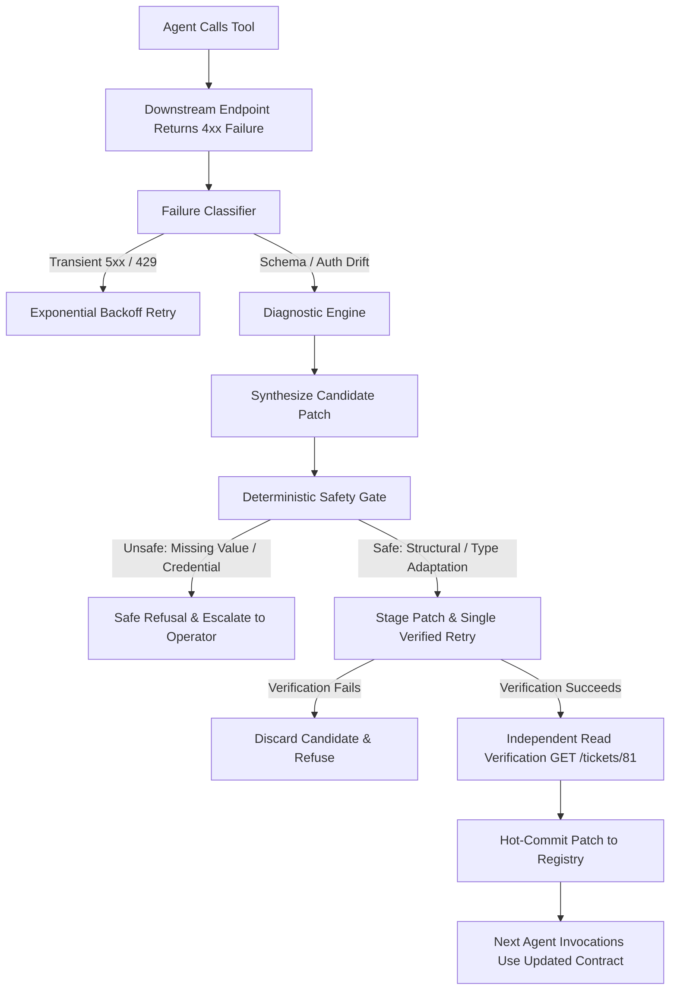

# DriftGuard Architecture & System Design

## 1. System Overview
DriftGuard is a resilient self-healing agent tool registry that eliminates runtime agent breakage caused by downstream API drift.

```
                      +---------------------------------------+
                      |       Frontend Dashboard (React)      |
                      |   Task Controls | Live Event Stream   |
                      |  Registry View  | Comparison Metrics  |
                      +-------------------+-------------------+
                                          |
                      REST Commands &     | SSE Stream
                      Run Triggers        | (/runs/{id}/events)
                                          v
                      +---------------------------------------+
                      |         Orchestrator Service          |
                      |          (FastAPI - Port 8000)        |
                      |                                       |
                      |  [Tool Registry (v1)]                 |
                      |  - find_user, assign_ticket, get_...  |
                      |                                       |
                      |  [Execution Engine]                   |
                      |  - Normal Workflow & Tool Caller      |
                      |  - SSE Event Broadcaster              |
                      |                                       |
                      |  [Healing Engine (Milestone 2)]       |
                      |  - Deterministic Diagnosis            |
                      |  - LLM-Assisted Safe Patch Planner    |
                      |  - Pre-Commit Verification            |
                      +-------------------+-------------------+
                                          |
                                          | HTTP Tool Invocations
                                          | (Strict isolation: No /admin access!)
                                          v
                      +---------------------------------------+
                      |           Downstream Mock API         |
                      |          (FastAPI - Port 8001)        |
                      |                                       |
                      |  [Business Endpoints]                 |
                      |  - GET  /users?name=Maya              |
                      |  - POST /tickets/assign               |
                      |  - GET  /tickets/{id}                 |
                      |                                       |
                      |  [Admin Endpoints (Evaluations only)] |
                      |  - POST /admin/reset                  |
                      |  - POST /admin/mutation               |
                      |  - GET  /admin/state                  |
                      +---------------------------------------+
```

---

## 2. Security & Diagnosis Isolation Boundary
A core architectural invariant of DriftGuard is **Zero Out-of-Band Knowledge in Diagnosis**:
1. The Orchestrator's healing diagnosis engine communicates with the Mock API **strictly** via ordinary business endpoints (`/users`, `/tickets/assign`, `/tickets/{id}`).
2. The Orchestrator **never** queries `/admin/state`, `/admin/mutation`, or hidden mock source code to discover the drift scenario.
3. Every repair proposal must be synthesized purely from runtime failure evidence:
   - HTTP status code (400, 401, 403, 404, 422)
   - Structured JSON validation errors (e.g. `code: "MISSING_REQUIRED_FIELD"`, `details: { expected_schema: ... }`)
   - Explicit migration hints if present in the response body.

---

## 3. Healing & Safety Architecture (Milestone 2 Design)



### Safety Invariants
1. **Model Proposes, Deterministic Validation Authorizes**:
   - The LLM synthesizes argument transforms, but a deterministic validator inspects the schema transform before execution.
2. **Immutable Business Intent**:
   - Target business entities (e.g., Ticket ID `81`, User ID `123`) cannot be mutated, guessed, or approximated.
3. **Refusal Over Hallucination**:
   - If an endpoint demands business fields not present in caller intent (Scenario 6), requires elevated credentials not in the vault (Scenario 7), or presents ambiguous choices (Scenario 8), DriftGuard refuses to guess and triggers operator escalation.
